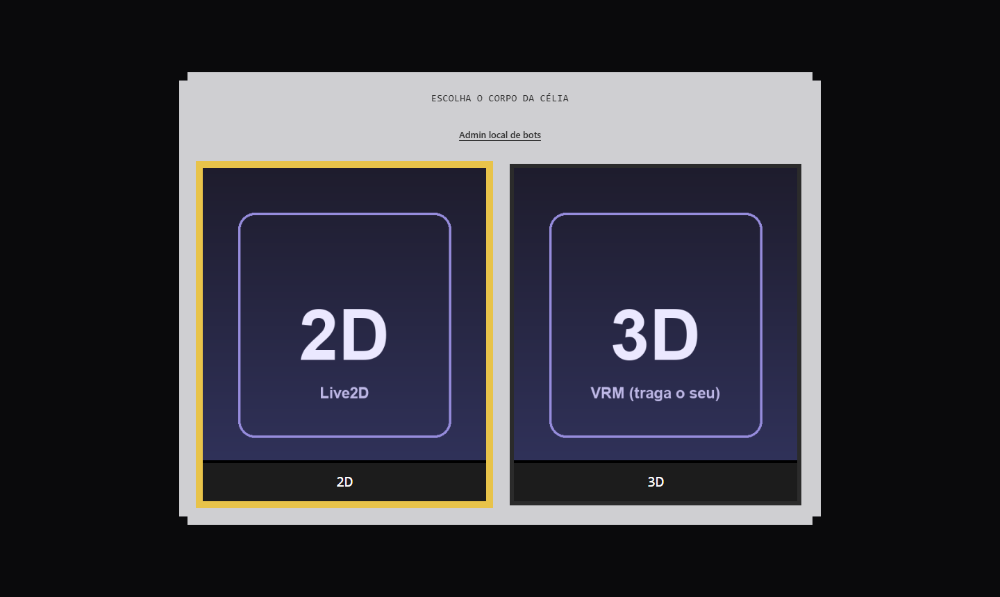
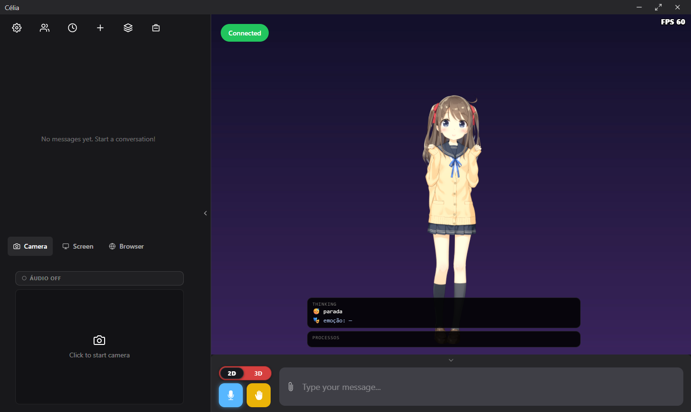
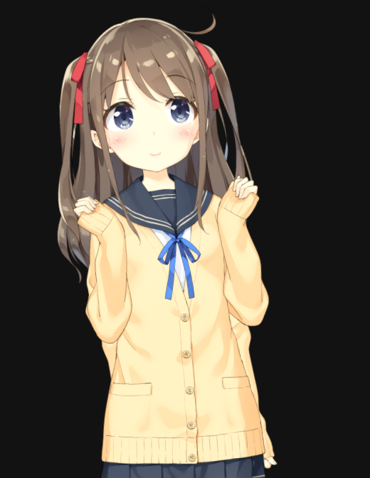
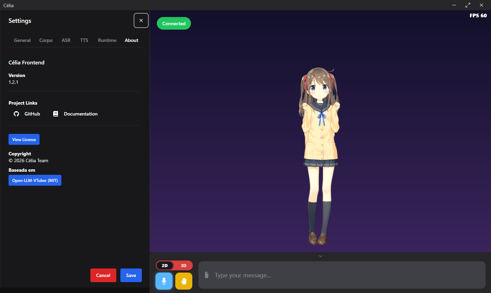

# Célia

Uma VTuber de IA com conversa, voz e avatar Live2D, que roda no seu computador.
Baseada no [Open-LLM-VTuber](https://github.com/Open-LLM-VTuber/Open-LLM-VTuber) (MIT), com um núcleo de comportamento próprio, modo Pet de desktop, ferramentas por MCP e uma interface em português.

> **Estado do projeto:** em desenvolvimento ativo. Parte dos recursos originais (integrações de jogos e bots) **não** está neste repositório. Veja [Limitações conhecidas](#limitações-conhecidas).
>
> **Cliente de voz V3 atualizado neste checkout local:** [Contrato público de geração com gate de biometria e seeds adaptativas](docs/CONTRATO-VOZ-V3-PUBLICO.md) (testes locais aprovados; requer Central IA privada executando a versão atualizada). O projeto público não inclui datasets, seedmap nem checkpoint de voz privados.

## Como é

| Escolha do corpo | Interface com o avatar |
|---|---|
|  |  |

| Modo Pet (só o personagem) | Sobre e créditos |
|---|---|
|  |  |

## Recursos

- Conversa por texto e voz, com histórico e persona configurável.
- Avatar **Live2D** com expressões ligadas às emoções da conversa e modo **Pet** (o personagem sozinho na área de trabalho).
- Ferramentas por **MCP** (busca, memória, enquetes, entre outras), ligadas por lista no `conf.yaml`.
- Fila de modelos com reserva por provedor e controle de cota (`config/model_chains.yaml`).
- Qualquer LLM com API compatível com a da OpenAI (Ollama, vLLM, LM Studio, provedores na nuvem).

## Começando

Requisitos: Python 3.10 a 3.12, e um servidor de LLM compatível com a API da OpenAI (por exemplo o [Ollama](https://ollama.com/)).

```powershell
git clone https://github.com/gamekena508-afk/celia-vtuber.git
cd celia-vtuber
python -m venv .venv
.venv\Scripts\python.exe -m pip install -r requirements.txt
copy conf.example.yaml conf.yaml
```

Edite o `conf.yaml` (modelo de LLM, voz) e suba:

```powershell
.venv\Scripts\python.exe run_server.py
```

Abra `http://127.0.0.1:12393/` e escolha **2D**.

Para só conferir a configuração, sem subir nada: `.venv\Scripts\python.exe launcher_config.py --check`.

## Configuração

Tudo fica no `conf.yaml` (copie de `conf.example.yaml`; ele **não** é versionado).

| O quê | Onde no arquivo | Observação |
|---|---|---|
| Persona | `character_config.persona_prompt` | O exemplo é genérico. Troque pelo texto da sua personagem. |
| Pessoas conhecidas | `character_config.known_people` | Lista de `name` e `notes`. Vazia por padrão. |
| LLM | `agent_config.llm_configs.openai_compatible_llm` | `base_url`, `model`, `llm_api_key`. |
| Voz (TTS) | `tts_config.tts_model` | `edge_tts` por padrão. Há opções locais (veja abaixo). |
| Reconhecimento de fala | `asr_config` | Qualquer servidor compatível com a API de transcrição da OpenAI. |
| Ferramentas MCP | `agent_settings.basic_memory_agent.mcp_enabled_servers` | Ative só as que você quer. |
| Modelo Live2D | `character_config.live2d_model_name` | Nome em `model_dict.json`. |

## Modelos Live2D

Este repositório inclui apenas o **Hiyori**, amostra oficial da Live2D Inc., sujeita ao *Free Material License Agreement* (veja `web/live2d-models/hiyori/NOTICE.txt`). Para usar o seu modelo, coloque a pasta em `web/live2d-models/` e acrescente uma entrada em `model_dict.json`.

**Respeite a licença de cada modelo.** Não publique modelos de terceiros sem permissão.

## Estrutura

```
src/celia/        núcleo: conversa, persona, voz, ferramentas, rotas
frontend/         interface web e scripts de apresentação (Live2D, Pet)
mcp/              servidores MCP
config/           filas de modelos, registro de bots
web/              modelos Live2D, fundos e avatares
tests/            testes automatizados (ver docs/TESTES.md)
```

## Testes

```powershell
.venv\Scripts\python.exe -m pytest -q
```

Veja [docs/TESTES.md](docs/TESTES.md) para o que foi retirado e por quê.

## Limitações conhecidas

- As integrações de jogos (Minecraft) e os bots (Discord, Twitch) **não** fazem parte deste repositório.
- A opção **3D** da tela inicial exige um modelo VRM seu; nenhum é distribuído aqui.
- O Hiyori não tem expressões faciais mapeadas, então a emoção aparece só no painel.
- Alguns recursos opcionais registram 404 no console do navegador por arquivos que não foram publicados.

## Créditos

- [Open-LLM-VTuber](https://github.com/Open-LLM-VTuber/Open-LLM-VTuber), de Yi-Ting Chiu e colaboradores (licença MIT): base de servidor, cliente e arquitetura.
- Modelo **Hiyori** e o runtime Cubism: Live2D Inc.
- Licenças de bibliotecas de terceiros em `requirements.txt` e `uv.lock`.

## Licença

MIT. Veja [LICENSE](LICENSE): mantém o aviso original do Open-LLM-VTuber e acrescenta o desta versão.
